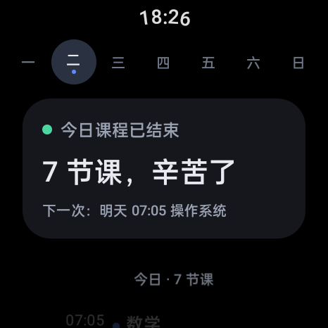
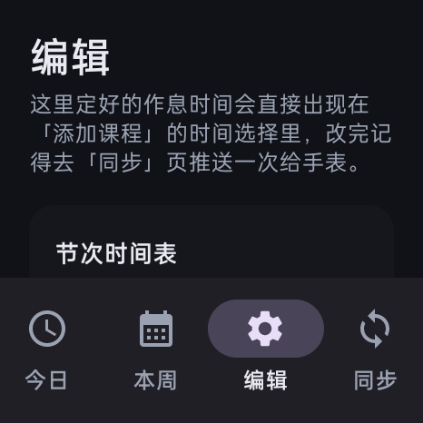
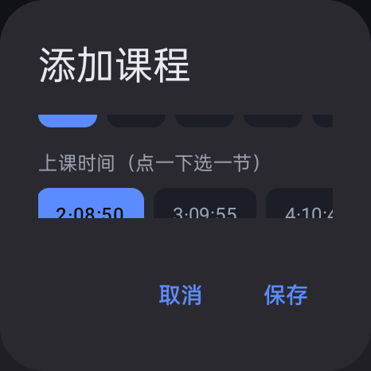

# ClassWatch · 抬腕看课表

给 **OPPO Watch X3（国行 ColorOS Watch）** 做的一块课表：
手表上抬腕就知道「现在第几节、下一节在哪」，
手机上随手改课表，一键推到手表。

 

> ⚠️ 注意：这不是标准 Wear OS 应用。OPPO Watch X3 国行跑的是
> **ColorOS Watch（Android 11 / 32 位）**，没有 Google 服务，
> 官方那套手机↔手表同步 API 全部不可用 —— 本项目的同步通道是自建的。

---

## 一、它能干什么

**手表端**

- 首屏一张大卡：当前/下一节课名、时间、教室、剩余分钟数
- 往下滚（或**转表冠**）看今天全部课程，已结束的会标灰
- **左右滑**切换星期一到星期日，顶部是一条可横滑的星期条
- 顶部常显「第 X 周 · 单周/双周」，列表底部显示手表当前 IP

**手机端**

- **今日**：今天一整天的课，点卡片直接改
- **本周**：周一到周日七天总览，按周次自动过滤
- **同步**：一键找到手表并推送课表，也支持导出/导入 JSON 备份
- **同步页右上角「编辑」**：设作息时间表（几点上课下课）和单双周总开关

改完作息后，添加课程时**直接点选时间段**就行，不用反复敲时间。

 

---

## 二、怎么用

### 1. 装到手表（必须用 release 包）

```bash
# 手表：设置 → 关于本机 → 连点版本号 7 次 → 开发者选项里打开 ADB 调试 / Wi-Fi 调试
adb connect 192.168.1.x:5555          # 手表上显示的 IP
./gradlew :watch:assembleRelease
adb -s 192.168.1.x:5555 install -r watch/build/outputs/apk/release/watch-release.apk
adb shell am start -n com.classwatch.watch/.ui.MainActivity
```

也可以直接从 [Releases](../../releases) 下载现成的 APK。

> **别装 debug 包**。实测 `dumpsys gfxinfo`：debug 中位 **150ms/帧（6fps）**，
> release（R8 + 非 debuggable）**16ms/帧**，APK 也从 25MB 压到 1.6MB。
> 32 位手表上这是能不能用的区别。

### 2. 装到手机并同步

```bash
./gradlew :phone:assembleRelease
adb install -r phone/build/outputs/apk/release/phone-release.apk
```

1. 手表 App **先打开一次**（同步服务跟着进程起来）
2. 手机和手表连**同一个 Wi-Fi**
3. 手机端「同步」页 → **自动找手表** → **推送课表**

> 扫描不到时先自查三点：手表 App 打开过没、两端是否同一 Wi-Fi（避开访客网络/AP 隔离）、
> 手机上有没有开 VPN。**ping 不通是正常的**，手表拦 ICMP，只要 TCP 能连就行。

只用命令行也能打包，不用装 Android Studio：

```bash
export JAVA_HOME=<JDK 17 路径>/Contents/Home
echo "sdk.dir=$ANDROID_HOME" > local.properties
./gradlew :watch:assembleRelease :phone:assembleRelease
./gradlew :shared:test          # 20 个引擎单测
```

---

## 三、原理

### 3.1 三个模块

```
shared/   纯 Kotlin：数据模型 + ScheduleEngine（排课计算），不依赖 Android
watch/    手表 App：Jetpack Compose + Wear Compose 1.4.0
phone/    手机 App：Material3，编辑 + 推送
```

时间推算、周次、单双周过滤这类逻辑**两端共用一份** ——
否则一定会出现「手机显示上课中、手表显示已下课」这种鬼故事。
核心就是一个纯函数：

```kotlin
ScheduleEngine.snapshot(timetable, now) -> Snapshot   // 当前？下一节？进度？全部条目？
```

### 3.2 同步：为什么不用官方 API

国行 OPPO 没有 GMS，`Wearable.getDataClient()` / `MessageClient` 全部失效。
所以自己拉了一条局域网直连通道，**不经过任何服务器**：

```
手机 ──UDP 8898 广播: CLASSWATCH_WHO──▶  手表
手表 ──单播: CLASSWATCH_HERE|192.168.1.108|8899──▶ 手机     ← 用来发现 IP
手机 ──TCP 8899: [4字节长度][UTF-8 JSON]──▶ 手表
手表 ──1 字节 ACK──▶ 手机
```

手表 IP 会变（DHCP），所以「自动找手表」是三层由快到慢的查找：
**上次记住的 IP → UDP 广播发现 → 扫网段**，任一层成功就停。

### 3.3 适配这块表的几个关键点

| 坑 | 现象 | 解法 |
|---|---|---|
| 缺 `com.google.android.wearable` 库 | APK 拒装（`INSTALL_FAILED_MISSING_SHARED_LIBRARY`） | manifest 删 `uses-library`，`uses-feature` 全设 `required=false`；Tile 组件彻底移除 |
| 表冠不是标准 `SOURCE_ROTARY_ENCODER` | `Modifier.rotaryScrollable` 收不到任何事件 | Activity 层拦 `ACTION_SCROLL` + `AXIS_VSCROLL`（实抓 `src=8194 dev=oplus_crown`），经 `RotaryBus` 转发给列表 |
| 只有 `armeabi-v7a` | 慢、容易卡 | release + R8；刷新从「每秒」改成「对齐分钟边界」；呼吸点动画改静态（静止时零重绘） |
| `Color(ULong)` 接 ARGB Long | 崩在 `drawCircle`：`ArrayIndexOutOfBoundsException: length=18; index=63` | ARGB 一律用 `Color(Int)` |
| `ScalingLazyColumn` 默认锚在第 1 项 | Hero 卡被顶出屏幕、TimeText 压住课程名 | `initialCenterItemIndex = 0` + `AutoCenteringParams` 调偏移 |

更完整的踩坑记录、性能实测数据、想法清单都在 **[docs/DETAILED.md](docs/DETAILED.md)**。

---

## 四、已知限制

- 同步服务跑在 App 进程里，进程被回收就收不到推送（要 7×24 可靠得改前台服务）
- 手表 App 至少要被打开过一次，监听才会起来
- 没有 AOD 常亮、没有课前震动提醒（前者费电、后者是个 `AlarmManager` 的事，还没做）

---

## 五、License

MIT
